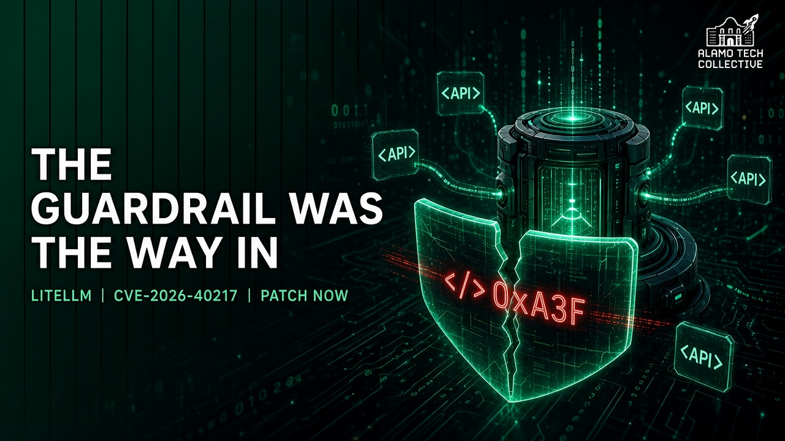

  

Your LLM gateway is the box that holds every provider API key your team owns. Last week CISA said it has evidence that attackers are exploiting one open-source gateway, LiteLLM, through the feature meant to keep it safe: the guardrails.

On November 18, CISA added [CVE-2026-40217, a code-execution bug in BerriAI's LiteLLM, to its Known Exploited Vulnerabilities (KEV) catalog](https://www.cisa.gov/news-events/alerts/2026/11/18/cisa-adds-four-known-exploited-vulnerabilities-catalog). KEV is the list of bugs CISA has [evidence are being exploited in the wild](https://www.cisa.gov/news-events/alerts/2026/11/18/cisa-adds-four-known-exploited-vulnerabilities-catalog). Not "could be." Are.

The fix has been out since April. If you run LiteLLM and haven't upgraded since spring, this one's your Thanksgiving homework.

## What happened

LiteLLM is an [open-source LLM proxy that puts one OpenAI-compatible API in front of 100+ model providers](https://www.x41-dsec.de/lab/advisories/x41-2026-001-litellm/), with load balancing, cost tracking, rate limiting, and guardrails. Guardrails are the filters that check prompts and responses on the way through.

One guardrail type lets you [write your own filter logic in Python-like code that "runs in a sandboxed environment"](https://docs.litellm.ai/docs/proxy/guardrails/custom_code_guardrail), with no imports, no file I/O, and no `exec()` or `eval()`. To try a filter before you save it, the proxy exposes a test endpoint: `POST /guardrails/test_custom_code`.

That sandbox didn't hold. According to [LiteLLM's security advisory](https://github.com/BerriAI/litellm/security/advisories/GHSA-wxxx-gvqv-xp7p), the endpoint ran user-supplied Python inside a "hand-rolled sandbox" that could be escaped with bytecode-level tricks, giving arbitrary code execution in the proxy process, which [runs as root in the default Docker image](https://github.com/BerriAI/litellm/security/advisories/GHSA-wxxx-gvqv-xp7p).

The researchers at X41 D-Sec, who are [credited with the find (Markus Vervier)](https://www.x41-dsec.de/lab/advisories/x41-2026-001-litellm/), published the full chain. The short version: the sandbox [blocked dangerous names with regex filtering on the source code](https://www.x41-dsec.de/lab/advisories/x41-2026-001-litellm/). So the exploit builds those names at runtime with string concatenation, rewrites a generator's bytecode to reach attributes the filter never saw, and pulls the real `__import__` out of one of the helper functions the sandbox hands you on purpose. A regex can't see a string that doesn't exist yet.

## Who's affected

- **Versions:** [litellm 1.81.8 through 1.83.9 on PyPI](https://osv.dev/vulnerability/GHSA-wxxx-gvqv-xp7p).
- **The fix:** LiteLLM [replaced the hand-rolled sandbox with `RestrictedPython`](https://github.com/BerriAI/litellm/security/advisories/GHSA-wxxx-gvqv-xp7p). The advisory says to [upgrade to 1.83.11 or later](https://github.com/BerriAI/litellm/security/advisories/GHSA-wxxx-gvqv-xp7p), though it also points to [`v1.83.10-stable`](https://github.com/BerriAI/litellm/releases/tag/v1.83.10-stable) as the patched release. Going to 1.83.11 or newer covers both readings. Both versions [hit PyPI in April 2026](https://pypi.org/project/litellm/#history), and the [current release is 1.110.2](https://pypi.org/project/litellm/) as of November 23.
- **Who can pull the trigger:** In default configurations, [reaching the endpoint requires a proxy-admin credential](https://github.com/BerriAI/litellm/security/advisories/GHSA-wxxx-gvqv-xp7p). X41 describes the attack as an [authenticated HTTP API request](https://www.x41-dsec.de/lab/advisories/x41-2026-001-litellm/). This isn't a drive-by bug, but anyone holding that key can own the box.
- **Severity:** [CVSS 3.1 score of 8.8 (High)](https://nvd.nist.gov/vuln/detail/CVE-2026-40217).
- **Bundled copies:** NVD's record also lists [Red Hat products that package LiteLLM](https://nvd.nist.gov/vuln/detail/CVE-2026-40217), including OpenShift AI and an Ansible Automation Platform component. If LiteLLM came to you inside someone else's product, check that vendor's fixed build.

The timeline matters. The CVE was [published to NVD in April 2026](https://nvd.nist.gov/vuln/detail/CVE-2026-40217), and GitHub's reviewed advisory [went up May 11](https://osv.dev/vulnerability/GHSA-wxxx-gvqv-xp7p). The KEV listing came [November 18](https://www.cisa.gov/news-events/alerts/2026/11/18/cisa-adds-four-known-exploited-vulnerabilities-catalog). Seven months of "we'll get to it" is exactly the window attackers live in.

## What CISA's listing does and doesn't say

CISA [gave federal civilian agencies until December 2, 2026](https://www.cisa.gov/known-exploited-vulnerabilities-catalog) to apply the vendor's mitigations or stop using the product. Under [Binding Operational Directive 26-04](https://www.cisa.gov/news-events/directives/bod-26-04-prioritizing-security-updates-based-risk), that deadline is binding only on those agencies. CISA [encourages everyone else to prioritize KEV bugs too](https://www.cisa.gov/news-events/alerts/2026/11/18/cisa-adds-four-known-exploited-vulnerabilities-catalog).

What the entry doesn't tell you: who's exploiting it, how they're getting the admin credential, or how many systems were hit. CISA lists [known ransomware use as "Unknown"](https://www.cisa.gov/known-exploited-vulnerabilities-catalog). We haven't found a primary source with exploitation details. Anything you read beyond that is a guess, and we're not going to make one here.

**The stopgap if you can't upgrade today:** LiteLLM's advisory says to [block `POST /guardrails/test_custom_code` at your reverse proxy or API gateway](https://github.com/BerriAI/litellm/security/advisories/GHSA-wxxx-gvqv-xp7p).

## What this means for San Antonio builders

*This section is our opinion and analysis, not reporting.*

A lot of the agent work happening around town runs through a gateway like this. If you were building at [Agent Builders Night](https://www.meetup.com/alamotechcollective/events/317290481/) this month, there's a decent chance LiteLLM or something like it sits between your agent and your API keys. That makes it one of the most valuable boxes you run, whether it feels like "infrastructure" or not.

Here's the 20-minute version before you leave for Thanksgiving:

1. **Find every copy.** Run `pip show litellm` in each environment, check the image tags on your proxy containers, and look for LiteLLM bundled inside other tools. Side projects count. That forgotten demo on a $5 VPS counts double.
2. **Upgrade to 1.83.11 or later.** If you can't, block the test endpoint at the edge today.
3. **Block it anyway.** If nobody on your team writes custom-code guardrails, there's no reason for that endpoint to be reachable from outside. Defense in depth is cheap here.
4. **Treat the admin key like a root password.** Exploitation needs a proxy-admin credential in default setups. If that key has lived in a `.env` file in a repo, a shared doc, or a Slack thread, rotate it. If an unpatched proxy was reachable from the internet, we'd also rotate the provider API keys it holds. That's cheaper than finding out.
5. **Stop running it as root.** LiteLLM publishes a [non-root image](https://hub.docker.com/r/litellm/litellm-non_root), and its [production docs show a `LITELLM_NON_ROOT` setting](https://docs.litellm.ai/docs/proxy/prod). Root wasn't the bug, but it's why the bug hurts this much.
6. **Keep the admin UI off the public internet.** Put it behind a VPN or an identity-aware proxy. Your users need the API. They don't need the admin panel.

The bigger lesson isn't about LiteLLM. **Guardrails are code, and code has bugs.** A safety feature that executes user-supplied logic is an attack surface first and a safety feature second. And "sandbox" built from a regex is a suggestion, not a wall. If you're building agent tooling that runs code from users or from models, use real isolation (a separate process, container, or VM with no secrets in it), not string filtering.

San Antonio has spent years [calling itself Cyber City](https://alamotechcollective.com/cybersecurity/san%20antonio/technology/2026/01/04/cyber-city-sa/). The AI tooling we're all wiring together is where that reputation gets tested next. If you build for federal civilian customers, assume they'll ask about that December 2 date.

## Talk about it in person

Three December meetups in town are good places to compare notes. Byte Night is ours; the other two are run by other groups, so check their pages for the latest.

- **[Geeks&&Drinks: San Antonio](https://www.meetup.com/meetup-group-umecjcqo/events/lssnbvyjcqbcb/)**, hosted by the Geeks&& Community. Tuesday, December 1, 6–8 PM CT, at Idle Beer Hall & Brewery, 414 Brooklyn Ave. Bring your patch story.
- **[Confidential Computing Leveraging Bootable Containers \|\| General Meeting](https://www.meetup.com/acm-sa/events/312889987/)**, from ACM San Antonio. Wednesday, December 9, 6–8 PM CT, hybrid. The Meetup page says the venue and speaker details are still to be announced: venue [TBD]. If "how do I isolate the thing that runs untrusted code" is on your mind after this week, the topic is right on point.
- **[Byte Night](https://www.meetup.com/alamotechcollective/events/317553386/)**, hosted by Alamo Tech Collective. Friday, December 11, 6 PM CT, at Zelifcam, 10200 San Pedro Ave. Laid-back, no pitches: bring a laptop and your patch-and-rotate war stories, or just come talk shop.

## Pitch us a talk

Got a LiteLLM setup you'd defend, a sandbox you've broken, or a war story about rotating keys at 2 AM? That's a talk. Our events come from the community, not from sponsors. Pitch it through our [Meetup group](https://www.meetup.com/alamotechcollective/) or grab one of us at an event.

Patch first. Then pie.

---

**Alamo Tech Collective**
Building San Antonio's tech community, one event at a time.

## Sources

- CISA. (2026, November 18). *CISA Adds Four Known Exploited Vulnerabilities to Catalog.* <https://www.cisa.gov/news-events/alerts/2026/11/18/cisa-adds-four-known-exploited-vulnerabilities-catalog>
- CISA. *Known Exploited Vulnerabilities Catalog* (entry CVE-2026-40217: added 2026-11-18, due 2026-12-02, ransomware use "Unknown"). <https://www.cisa.gov/known-exploited-vulnerabilities-catalog>
- CISA. *BOD 26-04: Prioritizing Security Updates Based on Risk.* <https://www.cisa.gov/news-events/directives/bod-26-04-prioritizing-security-updates-based-risk>
- NIST NVD. *CVE-2026-40217.* <https://nvd.nist.gov/vuln/detail/CVE-2026-40217>
- BerriAI/LiteLLM. *GHSA-wxxx-gvqv-xp7p: LiteLLM has a sandbox escape in custom-code guardrail.* <https://github.com/BerriAI/litellm/security/advisories/GHSA-wxxx-gvqv-xp7p>
- OSV. *GHSA-wxxx-gvqv-xp7p* (affected version range). <https://osv.dev/vulnerability/GHSA-wxxx-gvqv-xp7p>
- X41 D-Sec. *Advisory X41-2026-001: Guardrail Sandbox Escape in LiteLLM.* <https://www.x41-dsec.de/lab/advisories/x41-2026-001-litellm/>
- BerriAI/LiteLLM. *Release v1.83.10-stable.* <https://github.com/BerriAI/litellm/releases/tag/v1.83.10-stable>
- PyPI. *litellm release history.* <https://pypi.org/project/litellm/#history>
- LiteLLM docs. *Custom Code Guardrail.* <https://docs.litellm.ai/docs/proxy/guardrails/custom_code_guardrail>
- LiteLLM docs. *Production Best Practices.* <https://docs.litellm.ai/docs/proxy/prod>
- Docker Hub. *litellm/litellm-non_root.* <https://hub.docker.com/r/litellm/litellm-non_root>
- Alamo Tech Collective. (2026, January 4). *Cyber City SA.* <https://alamotechcollective.com/cybersecurity/san%20antonio/technology/2026/01/04/cyber-city-sa/>
- Meetup: Alamo Tech Collective <https://www.meetup.com/alamotechcollective/>; Agent Builders Night <https://www.meetup.com/alamotechcollective/events/317290481/>; Geeks&&Drinks: San Antonio (Dec 1) <https://www.meetup.com/meetup-group-umecjcqo/events/lssnbvyjcqbcb/>; ACM San Antonio General Meeting (Dec 9) <https://www.meetup.com/acm-sa/events/312889987/>; Byte Night (Dec 11) <https://www.meetup.com/alamotechcollective/events/317553386/>
